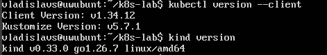
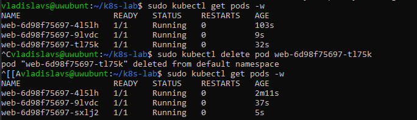
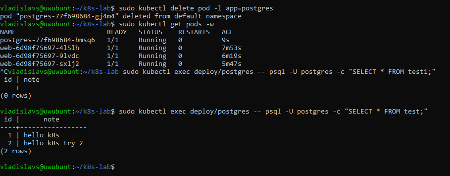

# Kubernetes-Lab-kind
Beginner hands-on lab: running a web app and a PostgreSQL database
on a local Kubernetes cluster created with kind.

## What I did
- Created a local cluster with `kind` and managed it with `kubectl`
- Deployed nginx with a Deployment and a Service (declarative YAML)
- Practiced scaling and self-healing by deleting pods
- Deployed PostgreSQL with a Secret (password) and a PersistentVolumeClaim
- Verified that data survives pod recreation

## Requirements
Docker, kubectl, kind (Linux, tested on Ubuntu Server in VirtualBox)

## Repository structure
manifests/  - Deployment, Service, PostgreSQL manifests

The secret is created by command and is intentionally not stored in the repo.

## Results

## What I learned
- Pod, Deployment and Service: what each one is responsible for
- Why Kubernetes restores deleted pods automatically
- Why a Secret and a PersistentVolume are used for credentials and data
- What is kibernetes and differences from docker

## Next steps
TBD
